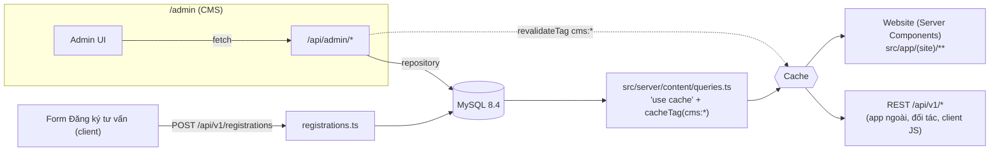

# 08 · Public API v1: tài liệu và ánh xạ màn hình

Tài liệu cho **API công khai của website** (`/api/v1`): mỗi endpoint trả gì, **màn hình nào và vị trí nào** dùng nó, ai sửa dữ liệu đó trong CMS.
API quản trị (`/api/admin`) là nội bộ cho CMS nên không mô tả ở đây.

|                  |                                                                                |
| ---------------- | ------------------------------------------------------------------------------ |
| Swagger UI       | **http://localhost:3000/api-docs** (bấm "Try it out" để gọi thử)               |
| OpenAPI 3.1 JSON | `GET /api/v1/openapi.json` (import được vào Postman/Insomnia, generate client) |
| Mã nguồn spec    | `src/server/openapi/spec.ts`                                                   |
| Route handlers   | `src/app/api/v1/**/route.ts`                                                   |
| Service + DTO    | `src/server/content/{queries,dto,mappers,registrations}.ts`                    |

---

## 1. Kiến trúc



- **Cùng một lớp service cho cả hai phía.** Trang web (Server Components) gọi trực tiếp các hàm trong `queries.ts`, không gọi HTTP vào chính mình (khuyến nghị của Next.js). REST `/api/v1/*` bọc đúng các hàm đó. Vì vậy **DTO trên web và trong API giống hệt nhau**: tài liệu này mô tả được cả hai.
- **Chỉ có nội dung đã xuất bản.** Khóa học, học viên, dự án, bài viết ở trạng thái `draft` không xuất hiện. Bài viết hẹn giờ (`publishedAt` trong tương lai) cũng chưa xuất hiện.
- **Cache và làm mới.**
  - Mỗi hàm đọc được cache (`cacheLife("hours")`) và gắn tag `cms:<collection|singleton>`.
  - Khi admin lưu, `/api/admin` gọi `revalidateTag(..., { expire: 0 })`. Lần tải trang hoặc gọi API kế tiếp nhận dữ liệu mới ngay, không phải đợi build lại.
  - Bảng tag ↔ màn hình ở mục 5.
- **Tương tác phía client** (form đăng ký) gọi thẳng REST API bằng `fetch`.

## 2. Quy ước chung

| Mục               | Quy ước                                                                                                                                                                                                                                                                                                                                                  |
| ----------------- | -------------------------------------------------------------------------------------------------------------------------------------------------------------------------------------------------------------------------------------------------------------------------------------------------------------------------------------------------------- |
| Base URL          | `{SITE_URL}/api/v1` (local: `http://localhost:3000/api/v1`)                                                                                                                                                                                                                                                                                              |
| Định dạng         | JSON UTF‑8. Thành công: `{ "data": …, "meta"?: … }`.                                                                                                                                                                                                                                                                                                     |
| Lỗi               | `{ "error": { "code", "message", "fields"? } }`. `message` bằng tiếng Việt, hiển thị được cho người dùng.                                                                                                                                                                                                                                                |
| Mã lỗi            | `not_found` 404 · `validation_error` 422 (kèm `fields`) · `bad_request` 400 (body không phải JSON) · `rate_limited` 429 · `server_error` 500                                                                                                                                                                                                             |
| CORS              | `Access-Control-Allow-Origin: *` cho mọi endpoint public (có `OPTIONS` cho `POST /registrations`)                                                                                                                                                                                                                                                        |
| Xác thực          | Không cần. Chỉ đọc, trừ `POST /registrations`.                                                                                                                                                                                                                                                                                                           |
| Ảnh               | `Image = { url, alt, width?, height? }`. `url` tương đối với website (`/images/...`, `/uploads/2026/11/...`) hoặc URL https tuyệt đối. `alt` = tiêu đề của nội dung chứa ảnh: tên khóa học, dự án, bài viết, đối tác…; album dự án là "`<tên dự án>` – ảnh N"; ảnh hero là tên website; ảnh trang About là tiêu đề trang. CMS không có ô nhập alt riêng. |
| Văn bản định dạng | Đoạn mở đầu, danh sách bài viết: markdown rút gọn trong `text` (`**đậm**`, `[nhãn](/link)`), `parts` là bản đã tách sẵn: `string \| { text, bold?, href? }`. Đoạn văn bài viết, câu chuyện học viên, mô tả dự án: HTML đã lọc (p, br, strong, em, u, a, ul, ol, li, blockquote).                                                                         |
| Thứ tự            | Danh sách trả theo thứ tự kéo‑thả trong CMS (bài viết: mới nhất trước).                                                                                                                                                                                                                                                                                  |
| Slug              | `{slug}` là slug của học viên, dự án, bài viết. Khóa học dùng id: `GET /courses/{id}`.                                                                                                                                                                                                                                                                   |

## 3. Danh mục endpoint (nhóm theo resource RESTful)

| Nhóm (tag Swagger) | Method & path             | Query / body                                                                 | Trả về                                                                                                       |
| ------------------ | ------------------------- | ---------------------------------------------------------------------------- | ------------------------------------------------------------------------------------------------------------ |
| **Site**           | `GET /site`               | –                                                                            | `Site`: tên, tagline, công ty, socials, SEO, menu `desktop / mobile / footer`                                |
| **Pages**          | `GET /pages/{page}`       | `page` ∈ `home, academy, students, projects, blog, about, contact, partners` | Nội dung biên tập của trang (schema riêng cho từng trang)                                                    |
| **Courses**        | `GET /course-categories`  | –                                                                            | `CourseCategory[]` (danh mục khóa học, theo thứ tự trong CMS)                                                |
|                    | `GET /courses`            | –                                                                            | `Course[]` (mỗi khóa học kèm `category`), `meta.total`, `meta.categories` (danh mục có khóa học đã xuất bản) |
|                    | `GET /courses/{id}`       | id khóa học                                                                  | `Course` (chương trình học, quyền lợi, giảng viên, lịch, học phí)                                            |
| **Students**       | `GET /students`           | `?featured=true` · `?role=DJ` (không phân biệt hoa thường)                   | `Student[]`                                                                                                  |
|                    | `GET /students/{slug}`    | –                                                                            | `Student` (câu chuyện đầy đủ)                                                                                |
| **Projects**       | `GET /project-categories` | –                                                                            | `ProjectCategory[]` (chip lọc)                                                                               |
|                    | `GET /projects`           | `?category={categorySlug}`                                                   | `ProjectSummary[]` (card)                                                                                    |
|                    | `GET /projects/{slug}`    | –                                                                            | `Project` (hero, thông tin, ảnh, video, album)                                                               |
| **Posts**          | `GET /posts`              | `?tag=` · `?page=1` · `?limit=12` (≤ 50)                                     | `PostSummary[]`, `meta: { page, limit, total, totalPages }`                                                  |
|                    | `GET /posts/{slug}`       | –                                                                            | `Post` (intro, blocks, SEO)                                                                                  |
| **Partners**       | `GET /partners`           | `?placement=home\|partners`                                                  | `Partner[]` (logo)                                                                                           |
|                    | `GET /collaborations`     | –                                                                            | `Collaboration[]` (dự án hợp tác)                                                                            |
| **Registrations**  | `POST /registrations`     | `{ name, phone, email?, courseId, source?, website }`                        | `201 { data: { id, status: "new", course, createdAt } }`                                                     |
| _(tài liệu)_       | `GET /openapi.json`       | –                                                                            | Spec OpenAPI 3.1                                                                                             |

### 3.1 Site: `GET /site`

```jsonc
{
  "data": {
    "name": "Hooked Entertainment",
    "tagline": "Support Local Artists",
    "description": "Hooked Entertainment sẽ là bệ phóng…",
    "company": {
      "legalName": "CÔNG TY TNHH HOOKED ENTERTAINMENT",
      "address": "Số 142B phố Đê La Thành, …",
      "email": "hooked.vie@gmail.com",
      "phone": { "display": "0966 609 807", "href": "tel:+84966609807" },
    },
    "socials": [{ "label": "Facebook", "href": "https://www.facebook.com/hookedvn" }],
    "seo": { "titleTemplate": "%s · Hooked Entertainment", "defaultTitle": "…", "ogImage": null },
    "navigation": {
      "desktop": [{ "label": "Home", "href": "/", "newTab": false }],
      "mobile": [{ "label": "Home", "href": "/", "newTab": false }],
      "footer": [{ "label": "About", "href": "/about", "newTab": false }],
    },
  },
}
```

Menu chỉ gồm mục đang bật hiển thị trong CMS (Cài đặt → Điều hướng).

### 3.2 Pages: `GET /pages/{page}`

| `page`     | Trường chính                                                                                                                                                                                                       | Ghi chú                                                                                                               |
| ---------- | ------------------------------------------------------------------------------------------------------------------------------------------------------------------------------------------------------------------ | --------------------------------------------------------------------------------------------------------------------- |
| `home`     | `hero{slides[{id, type, image, youtubeId}]}` (type = image hoặc video), `intro{titleLines, body}`, `highlights[]`, `services[]`, `blogCarousel{initialIndex, items[]}`, `partners{titleLines, body, cta, logos[]}` | `partners.logos` = đối tác bật "Hiện ở trang chủ"                                                                     |
| `academy`  | `seo`                                                                                                                                                                                                              | Tiêu đề "ACADEMY", nhãn các khối và nội dung form đăng ký là chữ cố định trên website                                 |
| `students` | `seo`                                                                                                                                                                                                              | Tiêu đề, mô tả, nhãn lưới, nhãn thẻ và nhãn trình đọc là chữ cố định trên website                                     |
| `projects` | `seo, cardLayout[]`                                                                                                                                                                                                | Tiêu đề, nút "Tất cả" và trạng thái rỗng là chữ cố định trên website                                                  |
| `blog`     | `seo`                                                                                                                                                                                                              | Tiêu đề "BLOGPOST" và đoạn mô tả là chữ cố định trên website                                                          |
| `about`    | `intro{title, eyebrow, lead, headlineLines, body, aside?}`, `ecosystem{titleLines, statement, body, capabilities[]}`, `portfolio{label, href}`, `photos{top[4], bottom[4]}`                                        | `photos.top`: khối ảnh sau phần mở đầu; `photos.bottom`: khối ảnh sau phần hệ sinh thái; mỗi khối 4 ảnh theo thứ tự ô |
| `contact`  | `eyebrow, title`, `contact{email, phone, address, legalName, socials}`                                                                                                                                             | `contact` lấy từ Cài đặt chung                                                                                        |
| `partners` | `title, body` (HTML), `logos[]`, `collaborations[]`                                                                                                                                                                | `logos` = đối tác bật "Hiện ở trang Partners"                                                                         |

### 3.3 Courses

`GET /courses/dj-co-ban`

```jsonc
{
  "data": {
    "id": "dj-co-ban",
    "title": "DJ cơ bản", // tên khóa học; website tự in hoa ở carousel, modal, form
    "category": { "id": "dj", "label": "DJ" },
    "description": "…",
    "instructors": [{ "label": "Giảng viên chính", "value": "Marcuz" }],
    "duration": "Từ 2 đến 3 tháng",
    "schedule": [{ "label": null, "value": "Chiều: 18h - 20h30" }],
    "tuition": "15.000.000 VND",
    "modules": ["…"],
    "benefits": ["…"],
    "image": { "url": "/images/academy/course-dj.png", "alt": "…", "width": 2550, "height": 1440 },
    "zoomTopLeft": false,
  },
}
```

### 3.4 Students

`Student = { id, slug, name, role, affiliation, portrait{url, alt, width, height, crop{scale, top} | null}, story: string, featured, headline | null }` — `story` là HTML đã lọc (p, br, strong, em, u, a, ul, ol, li, blockquote; liên kết ngoài có `target="_blank"`).

- `role` là chữ tự do nhập trong CMS (ví dụ "DJ", "MC HYPE"). `slug` được tạo tự động từ tên khi thêm học viên; trùng thì thêm `-1`.
- `crop` là thông số căn khung ảnh chân dung: ảnh rộng `scale` × khung và đẩy lên `top` × chiều cao ảnh.
- `headline` là câu tóm tắt trên carousel trang Academy, chỉ có ở học viên `featured`.

### 3.5 Projects

- `ProjectSummary = { id, slug, name, categories[{id, slug, label}], cover, featuredVideo | null }`
  - `name` viết thường như nhập trong CMS ("Devoid Music Festival"); website in hoa bằng CSS.
  - `categories` theo thứ tự chọn trong CMS: dùng để **lọc** (chip), làm **dòng nhãn dưới tên** trên card / trang chi tiết và danh sách "Dịch vụ cung cấp".
  - `featuredVideo` là video phát khi bấm nút ▶ trên card.
- `Project = ProjectSummary + { partners[], description, hero{image}, photos[], videos[{id, youtubeId, title, thumbnail}], albumLink{label, href | null} }`
- `cardLayout` (trong `GET /pages/projects`) là các ô của lưới "Tất cả" trên desktop, từ trên xuống: `[{ format, projectId }]`. `format`: `landscape` (cột 1–2), `portrait` (cột 3), `compact` (cột 1), `wide` (cột 2–3), `panorama` (cả 3 cột). Một dự án có thể nằm ở nhiều ô; ô có dự án chưa xuất bản bị bỏ qua; không còn ô nào thì mỗi dự án đã xuất bản một hàng full chiều ngang (lưới "Tất cả" không bao giờ trống khi có dự án). Ô xếp theo hàng, ô nào vừa chỗ trống phía trên thì lấp vào (CSS grid `dense`).
  - `description` là HTML đã lọc (p, br, strong, em, u, a, ul, ol, li, blockquote; liên kết ngoài có `target="_blank"`).
  - `hero.image` hiển thị nguyên ảnh, không cắt.

### 3.6 Posts

- `PostSummary = { id, slug, title, kicker, excerpt, cover, tags[], author, publishedAt, readingMinutes }`
  - `excerpt` không nhập trong CMS: là ~160 ký tự đầu của đoạn mở đầu (văn bản thuần, cắt theo từ). Cũng là mô tả SEO khi bài không có "Mô tả SEO".
- `Post = PostSummary + { intro{text, parts}, introCta | null, blocks[], seo{title, description, image | null} }`
- Các loại block (`type`):

| type        | Trường                 | Hiển thị                                |
| ----------- | ---------------------- | --------------------------------------- |
| `heading`   | `text`                 | Tiêu đề mục (H2)                        |
| `paragraph` | `html`                 | Một hoặc nhiều đoạn văn (HTML đã lọc)   |
| `list`      | `items[{text, parts}]` | Danh sách gạch đầu dòng                 |
| `image`     | `image`, `caption`     | Ảnh full‑width                          |
| `imagePair` | `images[2]`            | Hai ảnh cạnh nhau (xếp dọc trên mobile) |
| `quote`     | `text`, `cite`         | Trích dẫn                               |
| `cta`       | `label`, `href`        | Nút cam "→" trong bài                   |

### 3.7 Partners

- `Partner = { id, name, logo, website | null }`
- `Collaboration = { id, title, partnerLabel, href, image }`

### 3.8 Registrations: `POST /registrations`

```http
POST /api/v1/registrations
Content-Type: application/json

{ "name": "Nguyễn Văn A", "phone": "0912 345 678", "email": "a@gmail.com",
  "courseId": "dj-co-ban", "source": "Academy · carousel", "website": "" }
```

| Trường     | Bắt buộc | Kiểm tra                                                                                    |
| ---------- | -------- | ------------------------------------------------------------------------------------------- |
| `name`     | ✔        | 1–120 ký tự                                                                                 |
| `phone`    | ✔        | SĐT Việt Nam `^(\+?84\|0)[0-9 .-]{8,13}$`. Khi lưu, khoảng trắng, dấu chấm và gạch được bỏ. |
| `email`    |          | Email hợp lệ hoặc rỗng                                                                      |
| `courseId` | ✔        | id của khóa học **đã xuất bản**                                                             |
| `source`   |          | ≤ 120 ký tự: nơi người dùng mở form (hiện ở cột "Nguồn" trong CMS)                          |
| `website`  |          | **Honeypot**: luôn để rỗng. Có giá trị thì trả 422.                                         |

Kết quả:

- `201`: tạo lead trạng thái `new`, kèm lịch sử "Website". Lead xuất hiện ngay ở **CMS → Đăng ký tư vấn**, và chuông thông báo trên header admin đếm lead mới.
- `422`, ví dụ `{"error":{"code":"validation_error","message":"Dữ liệu không hợp lệ.","fields":{"phone":"Số điện thoại chưa đúng định dạng."}}}`. Form map `fields` vào từng ô.
- `429`: quá 5 lần trong 10 phút với cùng IP. Ngưỡng chỉnh bằng env `REGISTRATION_RATE_LIMIT`, `0` = tắt (dùng khi chạy e2e).

---

## 4. Màn hình → API (vị trí trên trang)

> Cột "Hàm service" là hàm mà Server Component gọi, tương đương endpoint REST cùng hàng.

### 4.0 Khung chung: mọi trang của website

| Vị trí                                                    | Endpoint                | Trường                                       |
| --------------------------------------------------------- | ----------------------- | -------------------------------------------- |
| Header desktop: menu ngang (≥ 1200px)                     | `GET /site` (`getSite`) | `navigation.desktop[]` (label, href, newTab) |
| Header mobile: nhãn trang hiện tại màu cam + menu overlay | `GET /site`             | `navigation.mobile[]`                        |
| Footer cột "Company"                                      | `GET /site`             | `navigation.footer[]`                        |
| Footer: tên pháp lý, địa chỉ, email, SĐT                  | `GET /site`             | `company.*`                                  |
| Footer: mạng xã hội                                       | `GET /site`             | `socials[]`                                  |
| `<title>` mặc định, template tiêu đề, OG image            | `GET /site`             | `seo.*`, `description`                       |

### 4.1 Trang chủ `/`

```
┌──────────────────────────────────────────────┐
│ HERO carousel (ảnh / video YouTube full màn)  │ ← pages/home.hero
├──────────────────────────────────────────────┤
│ INTRO  "SUPPORTING / LOCAL / ARTISTS."  + body│ ← pages/home.intro
├──────────────────────────────────────────────┤
│ HIGHLIGHTS  [Academy]      [Projects]         │ ← pages/home.highlights
├──────────────────────────────────────────────┤
│ SERVICES  4–5 dịch vụ (ảnh + mô tả + link)    │ ← pages/home.services
├──────────────────────────────────────────────┤
│ BLOG CAROUSEL  thẻ bài viết                   │ ← pages/home.blogCarousel
├──────────────────────────────────────────────┤
│ PARTNERS  tiêu đề + body + CTA + dải logo     │ ← pages/home.partners (+ logos)
└──────────────────────────────────────────────┘
```

| Vị trí                                                                    | Endpoint                                                | Trường                                                                                                                           |
| ------------------------------------------------------------------------- | ------------------------------------------------------- | -------------------------------------------------------------------------------------------------------------------------------- |
| Hero carousel: ảnh nền hoặc video YouTube (tự phát, không tiếng, lặp lại) | `GET /pages/home` (`getHomePage`)                       | `hero.slides[]`: `type`, `image` (ảnh slide hoặc ảnh chờ của video), `youtubeId`. Thời lượng cố định: ảnh 5 giây, video 15 giây. |
| Hero: chữ chạy (marquee)                                                  | Không gọi API                                           | Cố định theo thiết kế: "SUPPORT LOCAL ARTISTS" xen kẽ HOOKED ENTERTAINMENT                                                       |
| Khối giới thiệu                                                           | `GET /pages/home`                                       | `intro.titleLines[]`, `intro.body` (desktop tối đa 3 dòng, khoảng 115–120 ký tự; CMS giới hạn 130)                               |
| Hai ô nổi bật Academy / Projects                                          | `GET /pages/home`                                       | `highlights[]` (title, href, align, image)                                                                                       |
| Dịch vụ                                                                   | `GET /pages/home`                                       | `services[]` (title, titleLines, description, href, image)                                                                       |
| Carousel blog: thẻ, slide mở đầu                                          | `GET /pages/home`                                       | `blogCarousel.items[]`, `blogCarousel.initialIndex`                                                                              |
| Đối tác: tiêu đề, đoạn văn, nút "Đối tác của Hooked"                      | `GET /pages/home`                                       | `partners.titleLines`, `partners.body`, `partners.cta`                                                                           |
| Đối tác: dải logo                                                         | `GET /pages/home` (hoặc `GET /partners?placement=home`) | `partners.logos[]`: logo hiển thị bằng 73% kích thước gốc, cao tối đa 53px                                                       |

### 4.2 Academy `/academy`

```
┌──────────────────────────────────────────────┐
│ COURSES carousel: ảnh lớn, tiêu đề, thông tin, │ ← /courses
│   [Nội dung khóa học] [Đăng ký tư vấn]        │
├──────────────────────────────────────────────┤
│ DANH SÁCH KHÓA HỌC  chip lọc DJ/MC/Producer/Flip│ ← /courses (+ meta.categories)
│   dòng khóa học, hover hiện ảnh preview       │
├──────────────────────────────────────────────┤
│ CÂU CHUYỆN HỌC VIÊN carousel  [Xem tất cả]    │ ← /students?featured=true
└──────────────────────────────────────────────┘
  Overlay: Nội dung khóa học (modal)            ← /courses/{id}
  Overlay: Đăng ký tư vấn (modal form)          → POST /registrations
```

| Vị trí                                                                        | Endpoint                                                                                 | Trường                                                                                                                                                                                                          |
| ----------------------------------------------------------------------------- | ---------------------------------------------------------------------------------------- | --------------------------------------------------------------------------------------------------------------------------------------------------------------------------------------------------------------- |
| Tiêu đề trang, nhãn các khối                                                  | –                                                                                        | Chữ cố định theo thiết kế (`ACADEMY_COPY`): "ACADEMY", "Tất cả khóa học", "KHÓA HỌC", "HỌC VIÊN TIÊU BIỂU", "Tất cả câu chuyện"                                                                                 |
| Carousel khóa học: ảnh, tiêu đề, mô tả, giảng viên, thời lượng, lịch, học phí | `GET /courses` (`getCourses`)                                                            | `image`, `zoomTopLeft`, `title`, `description`, `instructors`, `duration`, `schedule`, `tuition`                                                                                                                |
| Danh sách khóa học: chip lọc                                                  | `GET /course-categories` + `GET /courses`                                                | Chip "Tất cả" + các danh mục có khóa học đã xuất bản, theo thứ tự kéo thả trong CMS (`meta.categories` của `/courses`)                                                                                          |
| Danh sách khóa học: dòng + ảnh preview khi hover                              | `GET /courses`                                                                           | `title`, `image`                                                                                                                                                                                                |
| Modal "Nội dung khóa học"                                                     | `GET /courses/{id}` (web đã có sẵn từ danh sách)                                         | `modules[]`, `benefits[]`, `instructors`, `schedule`, `tuition`                                                                                                                                                 |
| Carousel "Câu chuyện học viên"                                                | `GET /students?featured=true` (`getStudents({featured:true})`)                           | `name`, `role`, `headline`, `portrait` (+ `crop`); link `/academy/students?story={slug}`                                                                                                                        |
| Modal "Đăng ký tư vấn": tiêu đề, mô tả, ghi chú bảo mật, màn cảm ơn           | –                                                                                        | Chữ cố định theo thiết kế (`ACADEMY_COPY.registration`)                                                                                                                                                         |
| Modal "Đăng ký tư vấn": ô chọn khóa học                                       | `GET /courses`                                                                           | `id`, `title`                                                                                                                                                                                                   |
| Modal "Đăng ký tư vấn": nút Gửi                                               | **`POST /registrations`** (client `fetch`, `src/components/academy/registration-api.ts`) | body ở mục 3.8. `source` = `Academy · carousel` / `Academy · danh sách khóa học · chương trình học` / `Academy · carousel · chương trình học`. Lỗi 422 hiện dưới từng ô; 429/500/mất mạng hiện thông báo chung. |
| `<title>` / description                                                       | `GET /pages/academy`                                                                     | `seo`                                                                                                                                                                                                           |

### 4.3 Câu chuyện học viên `/academy/students`

| Vị trí                                                  | Endpoint                                            | Trường                                                                                                    |
| ------------------------------------------------------- | --------------------------------------------------- | --------------------------------------------------------------------------------------------------------- |
| Tiêu đề, mô tả, nhãn bộ sưu tập + "`n` HỌC VIÊN"        | `GET /students`                                     | Chữ cố định theo thiết kế (`studentsPage` trong `src/data/students.ts`); `n` = số học viên (`meta.total`) |
| Lưới thẻ học viên (8 DJ rồi 5 MC Hype theo thứ tự CMS)  | `GET /students` (`getStudents`)                     | `name`, `role`, `affiliation`, `portrait`, `crop`; nhãn "Xem câu chuyện" cố định                          |
| Reader (`?story={slug}`): ảnh, tên, vai trò, câu chuyện | `GET /students/{slug}` (web đã có sẵn từ danh sách) | `story` (HTML), `portrait`; nhãn "HỌC VIÊN TIÊU BIỂU" cố định                                             |
| `<title>` / description                                 | `GET /pages/students`                               | `seo`                                                                                                     |

### 4.4 Dự án `/projects`

| Vị trí                                                           | Endpoint                                                                  | Trường                                                                                                                                                                                                           |
| ---------------------------------------------------------------- | ------------------------------------------------------------------------- | ---------------------------------------------------------------------------------------------------------------------------------------------------------------------------------------------------------------- |
| Tiêu đề trang                                                    | –                                                                         | Chữ cố định theo thiết kế (`PROJECTS_COPY.title`)                                                                                                                                                                |
| Chip lọc dịch vụ (`?service=` trên URL, ví dụ link từ trang chủ) | `GET /project-categories` (`getProjectCategories`) + nút "Tất cả" cố định | `label`, `slug`                                                                                                                                                                                                  |
| Lưới card dự án                                                  | `GET /projects` (`getProjects`)                                           | `cover`, `name` (in hoa bằng CSS), `categories[].label` (dòng nhãn trên card), `categories[].slug` (thuộc chip nào). Ô của lưới "Tất cả" trên desktop: `GET /pages/projects` → `cardLayout[{format, projectId}]` |
| Nút ▶ trên card → lightbox YouTube                               | `GET /projects`                                                           | `featuredVideo{youtubeId, title, thumbnail}`                                                                                                                                                                     |
| Trạng thái rỗng (bộ lọc không có dự án)                          | –                                                                         | Chữ cố định (`PROJECTS_COPY.emptyState`)                                                                                                                                                                         |

### 4.5 Chi tiết dự án `/projects/{slug}`

| Vị trí                                    | Endpoint                              | Trường                                                                          |
| ----------------------------------------- | ------------------------------------- | ------------------------------------------------------------------------------- |
| Ảnh hero (nguyên ảnh, không cắt)          | `GET /projects/{slug}` (`getProject`) | `hero.image`                                                                    |
| Tiêu đề, nhãn dịch vụ                     | `GET /projects/{slug}`                | `name` (in hoa bằng CSS), `categories[].label`                                  |
| Đối tác, Dịch vụ cung cấp                 | `GET /projects/{slug}`                | `partners[]` (ẩn nếu rỗng), `categories[].label`                                |
| Mô tả dự án                               | `GET /projects/{slug}`                | `description` (HTML)                                                            |
| "Ảnh & video": ô ảnh → lightbox ảnh       | `GET /projects/{slug}`                | `photos[]`                                                                      |
| "Ảnh & video": ô video → lightbox YouTube | `GET /projects/{slug}`                | `videos[]`                                                                      |
| Link album                                | `GET /projects/{slug}`                | `albumLink.label`, `albumLink.href` (ẩn nếu `null`)                             |
| `<title>`, OG image                       | `GET /projects/{slug}`                | `name`, `description`, `cover`                                                  |
| Đường dẫn được build sẵn                  | `GET /projects`                       | `slug` (`generateStaticParams`). Dự án mới tạo trong CMS render khi có request. |

### 4.6 Blog `/blog` và `/blog/{slug}`

| Vị trí                          | Endpoint                        | Trường                                                                 |
| ------------------------------- | ------------------------------- | ---------------------------------------------------------------------- |
| `/blog`: tiêu đề, mô tả         | –                               | Chữ cố định (`BLOG_INDEX_COPY`); `GET /pages/blog` chỉ trả `seo`       |
| `/blog`: thẻ bài viết           | `GET /posts` (`getPosts`)       | `cover`, `kicker`, `title`, `excerpt`, `publishedAt`, `readingMinutes` |
| Chi tiết: header bài            | `GET /posts/{slug}` (`getPost`) | `kicker`, `title`, `cover`, `author`, `publishedAt`, `readingMinutes`  |
| Chi tiết: đoạn mở đầu + nút CTA | `GET /posts/{slug}`             | `intro.parts`, `introCta`                                              |
| Chi tiết: thân bài              | `GET /posts/{slug}`             | `blocks[]` (mục 3.6)                                                   |
| Chi tiết: `<title>`, OG         | `GET /posts/{slug}`             | `seo.title`, `seo.description`, `seo.image` (mặc định `cover`)         |
| Đường dẫn build sẵn             | `getPostSlugs()`                | slug bài đã xuất bản                                                   |

### 4.7 About `/about`

| Vị trí                                                               | Endpoint                            | Trường                                             |
| -------------------------------------------------------------------- | ----------------------------------- | -------------------------------------------------- |
| Intro: tiêu đề, eyebrow, lead, headline 2 dòng, body, đoạn phụ       | `GET /pages/about` (`getAboutPage`) | `intro.*`                                          |
| Khối ảnh sân khấu (4 ô)                                              | `GET /pages/about`                  | `photos.top[0..3]`                                 |
| Hệ sinh thái: tiêu đề, statement, body, danh sách năng lực (có link) | `GET /pages/about`                  | `ecosystem.*`, `capabilities[]{lead, rest, href?}` |
| Link "portfolio"                                                     | `GET /pages/about`                  | `portfolio{label, href}`                           |
| Khối ảnh live (4 ô)                                                  | `GET /pages/about`                  | `photos.bottom[0..3]`                              |

### 4.8 Contact `/contact`

| Vị trí                                | Endpoint                                | Trường                                 |
| ------------------------------------- | --------------------------------------- | -------------------------------------- |
| Eyebrow, tiêu đề, email lớn           | `GET /pages/contact` (`getContactPage`) | `eyebrow`, `title`, `contact.email`    |
| Nhãn "GỌI HOOKED / ĐỊA CHỈ / KẾT NỐI" | –                                       | Chữ cố định (`contactCopy.labels`)     |
| Số điện thoại (link `tel:`)           | `GET /pages/contact`                    | `contact.phone`                        |
| Tên công ty + địa chỉ                 | `GET /pages/contact`                    | `contact.legalName`, `contact.address` |
| Mạng xã hội                           | `GET /pages/contact`                    | `contact.socials[]`                    |

### 4.9 Partners `/partners`

| Vị trí                                             | Endpoint                                                        | Trường                        |
| -------------------------------------------------- | --------------------------------------------------------------- | ----------------------------- |
| Tiêu đề, đoạn giới thiệu (nhãn "PARTNERS" cố định) | `GET /pages/partners` (`getPartnersPage`)                       | `title`, `body` (HTML đã lọc) |
| Lưới logo                                          | `GET /pages/partners` (hoặc `GET /partners?placement=partners`) | `logos[]`                     |
| Dự án hợp tác (ảnh + nhãn đối tác + link)          | `GET /pages/partners` (hoặc `GET /collaborations`)              | `collaborations[]`            |

### 4.10 Khác

| Màn hình                             | Nguồn                                                                                                                                                                      |
| ------------------------------------ | -------------------------------------------------------------------------------------------------------------------------------------------------------------------------- |
| `sitemap.xml` (`src/app/sitemap.ts`) | `getProjects`, `getPosts` (slug, `publishedAt` = lastModified) + các route tĩnh                                                                                            |
| `robots.txt` (`src/app/robots.ts`)   | Không gọi API; chặn `/admin`, `/api/admin`                                                                                                                                 |
| 404, lỗi                             | Nội dung cố định (không gọi API). Slug không tồn tại hoặc đang Nháp hiện trang 404 có `noindex`; HTTP 200 vì `notFound()` chạy trong Suspense (cách Next 16 stream trang). |

---

### 4.11 Cách website dùng dữ liệu (code)

| Bước                                                 | File                                                                                                                         |
| ---------------------------------------------------- | ---------------------------------------------------------------------------------------------------------------------------- |
| Page (Server Component) gọi hàm service              | `src/app/(site)/**/page.tsx`, `layout.tsx`                                                                                   |
| Map DTO → props của component                        | `src/server/content/views/{site,home,editorial,academy,projects,blog}.ts` (`toPhoto` trong `views/photo.ts`)                 |
| Component chỉ nhận props, không import nội dung tĩnh | `src/components/**`                                                                                                          |
| SEO từng trang                                       | `generateMetadata` đọc `seo` của trang trong CMS. About, Contact, Partners không có trường SEO nên lấy từ nội dung.          |
| Đường dẫn build sẵn                                  | `generateStaticParams` từ database. Database rỗng thì trả slug giữ chỗ (`__no-project__`, `__no-post__`) để build không lỗi. |
| Nội dung mới sau khi build                           | Slug mới tạo trong CMS render khi có request: shell tĩnh trước, nội dung stream sau.                                         |

> **Ghi chú**
>
> - `src/data/*` giờ chỉ là **nguồn seed** cho database. Ngoại lệ: bố cục album ảnh vẽ tay theo Figma và độ zoom poster video (`project-details.ts`) vẫn lấy từ đây, vì CMS chưa có trường cho chúng. Bố cục này chỉ áp dụng khi ảnh và video của dự án chưa đổi; đổi rồi thì album tự chia cột cân bằng.
> - **Production:** lưu ở CMS thì request kế tiếp có nội dung mới ngay (đã kiểm tra).
> - **`pnpm dev`:** trang tĩnh đôi khi cần tải lại thêm một lần mới thấy thay đổi.

## 5. API → màn hình (tra ngược) và nơi sửa trong CMS

| Endpoint                            | Màn hình dùng                                             | Sửa ở CMS (`/admin/...`)                                                                                               | Cache tag bị làm mới khi lưu               |
| ----------------------------------- | --------------------------------------------------------- | ---------------------------------------------------------------------------------------------------------------------- | ------------------------------------------ |
| `GET /site`                         | Mọi trang (header, menu mobile, footer, SEO)              | Cài đặt chung `/admin/settings` · Điều hướng `/admin/navigation`                                                       | `cms:settings`, `cms:navigation`           |
| `GET /pages/home`                   | `/`                                                       | Trang chủ `/admin/pages/home` · Đối tác `/admin/partners`                                                              | `cms:home`, `cms:partners`                 |
| `GET /pages/academy`                | `/academy` + modal đăng ký                                | Trang › Academy `/admin/pages/academy`                                                                                 | `cms:academyPage`                          |
| `GET /pages/students`               | `/academy/students`                                       | Trang › Học viên tiêu biểu `/admin/pages/students`                                                                     | `cms:studentsPage`                         |
| `GET /pages/projects`               | `/projects`                                               | Trang › Projects `/admin/pages/projects`; `cardLayout`: Quản lý dự án › Cài đặt hiển thị dự án `/admin/project-layout` | `cms:projectsPage`, `cms:projectsLayout`   |
| `GET /pages/blog`                   | `/blog`                                                   | Trang › Blog `/admin/pages/blog`                                                                                       | `cms:blogPage`                             |
| `GET /pages/about`                  | `/about`                                                  | Trang › About `/admin/pages/about`                                                                                     | `cms:aboutPage`                            |
| `GET /pages/contact`                | `/contact`                                                | Trang › Contact `/admin/pages/contact` + Cài đặt chung `/admin/settings`                                               | `cms:contactPage`, `cms:settings`          |
| `GET /pages/partners`               | `/partners`                                               | Trang › Partners `/admin/pages/partners` (gồm Dự án hợp tác) · Đối tác `/admin/partners`                               | `cms:partnersPage`, `cms:partners`         |
| `GET /courses`, `/courses/{id}`     | `/academy` (carousel, danh sách, modal, form)             | Khóa học `/admin/courses`                                                                                              | `cms:courses`                              |
| `GET /course-categories`            | `/academy` (chip lọc danh sách khóa học)                  | Quản lý Academy › Danh mục khóa học `/admin/course-categories`                                                         | `cms:courseCategories` (kèm `cms:courses`) |
| `GET /students`, `/students/{slug}` | `/academy` (carousel), `/academy/students` (lưới, reader) | Quản lý Academy › Học viên `/admin/students`                                                                           | `cms:students`                             |
| `GET /project-categories`           | `/projects` (chip lọc), nhãn trên card và trang chi tiết  | Quản lý dự án › Danh mục dự án `/admin/project-categories`                                                             | `cms:projectCategories`                    |
| `GET /projects`, `/projects/{slug}` | `/projects`, `/projects/{slug}`, sitemap                  | Quản lý dự án › Dự án `/admin/projects`                                                                                | `cms:projects`                             |
| `GET /posts`, `/posts/{slug}`       | `/blog`, `/blog/{slug}`, sitemap                          | Bài viết `/admin/posts`                                                                                                | `cms:posts`                                |
| `GET /partners`                     | `/` (dải logo), `/partners` (lưới logo)                   | Đối tác `/admin/partners`                                                                                              | `cms:partners`                             |
| `GET /collaborations`               | `/partners`                                               | Trang › Partners `/admin/pages/partners`, mục Dự án hợp tác                                                            | `cms:partnersPage`                         |
| `POST /registrations`               | Modal "Đăng ký tư vấn" trên `/academy`                    | Kết quả xem ở Đăng ký tư vấn `/admin/leads`                                                                            | (ghi) không dùng cache                     |

> Lưu ý: carousel blog trên trang chủ là danh sách biên tập riêng (`home.blogCarousel`), không tự lấy từ `/posts`. Biên tập viên chọn ảnh, câu và link trong CMS Trang chủ.

---

## 6. Gọi thử

```bash
# Cấu hình + menu
curl -s http://localhost:3000/api/v1/site | jq '.data.navigation.desktop'

# Khóa học thuộc danh mục DJ (danh sách danh mục: /api/v1/course-categories)
curl -s 'http://localhost:3000/api/v1/courses' | jq '.data[] | select(.category.id == "dj") | .title'

# Dự án thuộc danh mục Media
curl -s 'http://localhost:3000/api/v1/projects?category=media' | jq '.data[].slug'

# Bài viết, trang 1, 6 bài/trang
curl -s 'http://localhost:3000/api/v1/posts?page=1&limit=6' | jq '.meta'

# Đăng ký tư vấn
curl -s -X POST http://localhost:3000/api/v1/registrations \
  -H 'content-type: application/json' \
  -d '{"name":"Nguyễn Văn A","phone":"0912345678","courseId":"dj-co-ban","source":"curl"}'
```

## 7. Thêm hoặc sửa một endpoint

1. Thêm hàm đọc vào `src/server/content/queries.ts`: `"use cache"`, gọi `tags("<collection>", …)`, trả DTO, và khai báo kiểu trong `dto.ts` / `mappers.ts`.
2. Tạo `src/app/api/v1/<resource>/route.ts`, bọc bằng `withPublic`, trả `Response.json({ data, meta })`.
3. Khai báo path và schema trong `src/server/openapi/spec.ts`. Swagger UI cập nhật ngay.
4. Nếu dữ liệu mới thuộc collection hoặc singleton khác, kiểm tra `affectedKeys()` trong `src/server/api/admin-keys.ts` để lưu ở admin làm mới đúng tag.
5. Cập nhật tài liệu này: mục 3, mục 4 (vị trí trên màn hình) và mục 5.
